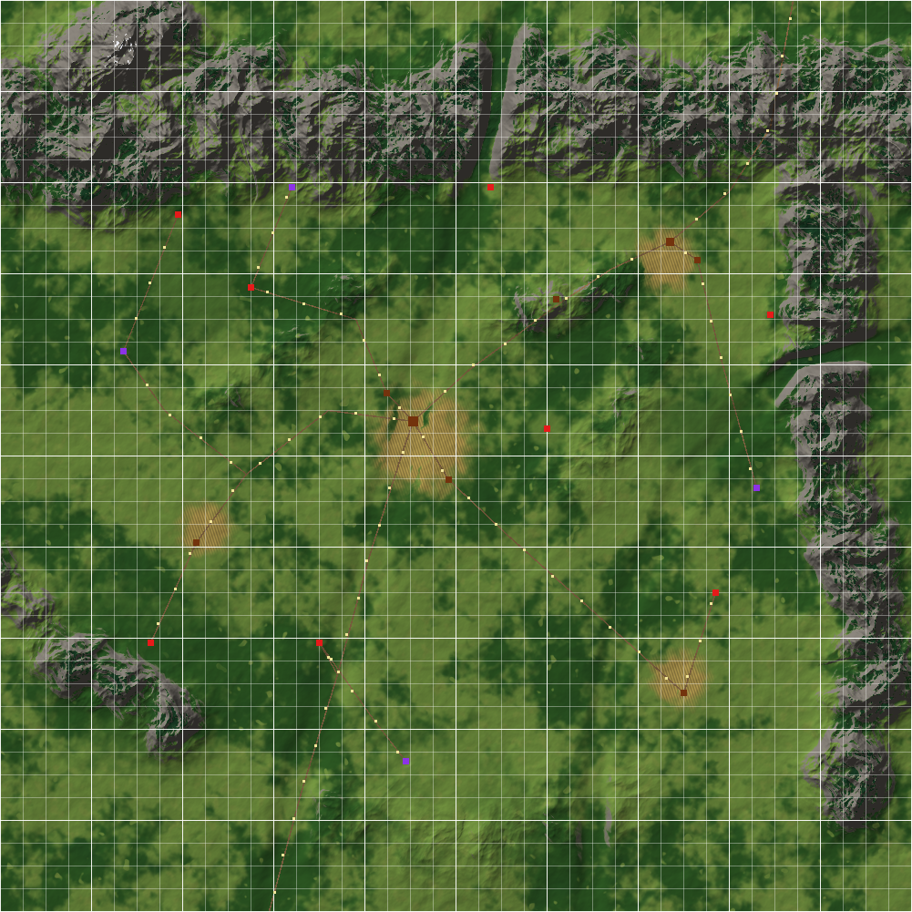

# Eldermark: a streamable USD test world

A procedural generator for a 10 km × 10 km medieval-fantasy landscape. It is authored as best-practice OpenUSD
with the standard **UsdLod** schemas (OpenUSD 26.08), for testing open-world streaming and LOD in an engine. It
contains terrain with eroded mountains, valleys, forests and farmland, villages, a castle, ruins and a few uncanny
sites. The world is cut into a region/tile cell hierarchy: every cell is a LOD root with payloaded levels and
streaming-domain heuristics, the terrain has 50 m ground chunks with a 0.5 m fine level, and every asset has 8
LOD levels.

The generated world (`world/`, about 24 GB) is **not** in the repository. You regenerate it from the generator
and `config/world.toml`; output is deterministic for a given seed and configuration.



## Repository layout

| Path | What it is |
|---|---|
| `generator/` | the generator (Python package `streamworld`), run scripts, a usdview plugin. Reference: [`generator/README.md`](generator/README.md) |
| `config/world.toml` | every parameter: seed, partition and LOD thresholds, terrain, biomes, points of interest, roads, density, flight path, lighting |
| `docs/DESIGN.md` | the world's design and USD structure |
| `docs/LOD_STREAMING.html` | the LOD and streaming specification (open in a browser): hierarchy, heuristics, residency, physics, engine checklist |
| `docs/VALIDATION.md` | what validation checks and the latest results |
| `docs/previews/` | renders of the viewpoints, the map, usdview screenshots, the LOD test tree |
| `PROMPT.md` | the original task specification |
| `usdlod_notes.md` | an annotated walk through a UsdLod asset file |
| `world/` | generated output (git-ignored) |
| `build/` | caches and logs (git-ignored) |
| `openusd_build/` | the local OpenUSD build (git-ignored, see below) |

## Requirements

- Linux with 16 GB or more of free memory for a full run (28 GB machine used here) and about 30 GB of disk.
- **OpenUSD 26.08** with Python, imaging and usdview, built into `openusd_build/` at the repository root. The
  system's OpenUSD usually predates UsdLod, so use this build. Build it once from the OpenUSD sources:

  ```sh
  git clone --depth 1 --branch v26.08 https://github.com/PixarAnimationStudios/OpenUSD.git ../OpenUSD
  python3 ../OpenUSD/build_scripts/build_usd.py --no-materialx "$PWD/openusd_build"
  ```

  (Release build with imaging, usdview and Python; the Storm `hioOpenEXR` plugin it builds is needed for the HDR
  sky.)
- **Python 3.14** (the version OpenUSD was built against) with `numpy`, OpenImageIO's Python module
  (`OpenImageIO`), and `PySide6` for usdview.
- **Blender 5.2** on `PATH` (or set `BLENDER=/path/to/blender`). It is used at generation time only, for mesh
  decimation and convex hulls.

Check the setup:

```sh
. generator/env.sh
python3 -c "from pxr import Usd, UsdLod; print(Usd.GetVersion())"   # (0, 26, 8)
```

## Quick start

All commands run from the repository root.

```sh
generator/run.sh generate                 # one region (R_4_5, the village of Elderford): terrain cache + assets + region, ~15 min the first time
generator/usdview.sh                      # view it in usdview with the UsdLod plugin (menu "UsdLod")
```

The first run builds the terrain cache in `build/cache/` (about 15 minutes). Later runs reuse it as long as
`[terrain]` is unchanged.

The full world:

```sh
generator/run.sh generate --regions all   # 100 regions, ~50 min + ~11 min for root and manifest, 24 GB
generator/run.sh validate                 # all checks, ~45 min, writes world/validation.json (--quick skips usdchecker)
generator/run.sh stream-replay            # simulate streaming along the flight path -> world/stream_replay.json
generator/run.sh preview                  # LOD-aware renders of the viewpoints -> docs/previews/
generator/run.sh map                      # overview map -> docs/previews/map.png
```

`generator/run.sh validate` runs inside a memory-capped systemd scope (`STREAMWORLD_MEM_MAX`, default 16G), so a
runaway check gets killed on its own instead of taking the terminal with it. Close large applications before a
full generate or validate.

Other useful commands (all options are in [`generator/README.md`](generator/README.md)):

```sh
generator/run.sh generate --regions R_4_5 R_6_6       # specific regions
generator/run.sh generate --cells R_4_5/T_2_1         # regenerate one tile, then: generator/run.sh manifest
generator/run.sh generate --density light             # lighter vegetation for quick iterations
generator/run.sh generate --force-assets              # rebuild the asset library after changing assets
generator/usdview.sh world/root.usda --unloaded       # open without loading payloads
```

## Using the world

- Open `world/root.usda`. It sublayers the lights (`layers/environment.usda`: sun plus an HDR sky dome) and the
  cameras (`layers/viewpoints.usda`: 11 named viewpoints and a 59-camera flight path).
- A reader that ignores UsdLod sees each root's default level, which is the coarsest: the whole map as region
  proxies, with collision on exactly those default levels.
- A LOD-aware reader evaluates the UsdLod heuristics (imaging, physics, and the `streaming` domain with load and
  unload radii), loads the payloads it selects and shows one level per root. `generator/streamworld/lodselect.py`
  is a standalone reference implementation of this, and `docs/LOD_STREAMING.html` is the specification for an
  engine.
- `world/manifest.json` lists the hierarchy, per-level costs, viewpoints, the flight path and the expected LOD
  selections.
